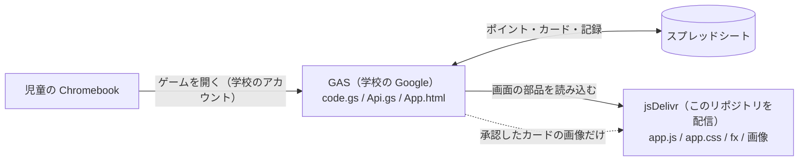

# 漢字の刃（画面のプログラムと素材）

小学6年生向けの漢字学習ゲーム「漢字の刃」のうち、**画面の見た目と動き（JavaScript・CSS・画像）** を置いているリポジトリです。
学校の Google（GAS）で動くゲームの画面が、**jsDelivr（cdn.jsdelivr.net）** を通してこのリポジトリのファイルを読み込みます。
（児童のタブレットでは、学校のネットワークで GitHub Pages〔github.io〕が開けないため）

> ⚠️ **このリポジトリは誰でも見られます（Public）。**
> 児童の名前・出席番号・パスワード・メールアドレス・テストの点数、スプレッドシートのID、GAS の URL、合言葉（トークン）、クイズの正解、ガチャの確率は **絶対に置かないでください**。
> それらはすべて GAS とスプレッドシートの中だけにあります。

---

## 1. 全体のしくみ（はじめての人へ）

漢字の刃は **2つの場所** に分かれています。

| | GAS（Google Apps Script） | GitHub（このリポジトリ） |
|---|---|---|
| 置いてあるもの | サーバーのプログラム（`code.gs`・`Api.gs`）、外枠の HTML、今までの画面 | 新しい画面の動き（`app.js` など）、見た目（`app.css`）、演出（`fx/`）、カードと偉人の画像 |
| データ | スプレッドシート（児童・カード・記録） | **データは置かない** |
| 公開の範囲 | 学校のアカウント（昭島市教育委員会内）だけ | インターネットに公開 |
| 更新のしかた | GAS のエディタに貼り付け → 「新バージョン」でデプロイ | GitHub Desktop で commit → Push |
| 説明書 | `README_GAS.md`（GAS のファイルと一緒に、先生のパソコンに保管。**GitHub には置かない**） | この README |

- ポイント・ガチャの結果・勝ち負けなど、**大事なことはすべて GAS（サーバー）が決めます**。このリポジトリのプログラムは、見せ方だけを担当します。
- jsDelivr のファイルが読めないときも、データは GAS とスプレッドシートにあるので消えません。

---

## 2. ファイルの一覧（`web/` フォルダ）

| ファイル | 中身 |
|---|---|
| `app.js` | 新しい1ページ型の画面（ログイン・マイページ・行き先の大きなタイル・ランキング）。先生のときは `admin.js`、カードを作るときは `cardmake.js` をあとから読み込む。キーボード：数字キーで行き先へ・矢印キーでえらぶ・M でメニュー |
| `app.css` | 新しい画面の見た目。ログイン・マイページはドット絵（2026-10-30 から）。カードを作る・レイド・管理画面は未来風のまま |
| `pixel.css` | ドット絵の見た目（PICO-8 の16色・DotGothic16・ドットの枠とボタン・メニュー）。GAS の FxBridge が読み込み、`fx/pixel.js` の一覧にある画面だけに効く |
| `fx/pixel.js` | ドット絵の部品（点のアイコン・城下町の背景・画面を出るときのタイル・光の点滅は1秒に2回まで）。いちばん上の `PAGES` に画面の名前を足すと、その画面がドット絵になる |
| `theme.css` | マイページと同じ未来風の見た目を、ガチャ・バトル・図鑑・クイズ・ステップアップにもかける（GAS の FxBridge が読み込む。ドット絵にした画面では使わない） |
| `admin.js` | 先生の管理画面（児童一覧・ポイントの記録・ログインの記録・カードの承認・カード一覧と編集・説明書）。**先生のときだけ**読み込む。承認・画像の差しかえのとき、子どもの絵をカードの型に当てはめた画像をこの画面で作る。説明書の文章はここには置かず、GAS から先生にだけ届く |
| `raid.js` | 巨大レイドボスの画面（週末・月末だけ。マイページの知らせを押すと読み込む）。正解・ダメージ・ごほうびはサーバーが決める |
| `cardmake.js` | 「カードを作る」画面（児童が絵・名前・手・ステップアップの効果を申請する） |
| `fx/fx.js` | 演出（じゃんけん・サイコロ〔ダブルダイスは2個〕・ボス戦・ガチャ開封〔パックはタップでやぶる。切れ目が横に走る〕・ダメージの掛け算〔×3 などが飛んできて数字が燃える〕・宝箱・宝箱ルーレット・貧乏神・WARNING とボス登場・手ごとの攻撃〔グー岩・チョキ斬撃・パー竜巻〕・総攻撃カットイン・覚醒・レイドボス・タップの粒など。ドット絵×アニメ風。光の点滅は1秒に2回まで） |
| `fx/eras.js` | ステップアップバトルの「時代の背景」10種（埴輪・五重塔・金閣・黒船など） |
| `fx/bgm.js` | ゲームの音楽（10/31〜）。音のファイルは使わず、ブラウザの中で音を作る。曲はすべてオリジナル（江戸風：五音音階・三味線・笛・琴・和太鼓ふう／ファミコン風：矩形波2つ・三角波・ノイズ）。ページと場面を見分けて曲を変える。最初のタップで鳴る。左下の 🔊/🔇 と 🎚（音量）は端末に覚える。はじめてオンにするかは、いちばん上の `DEFAULT_ON` |
| `fx/demo.html` | 演出のお試しページ（ゲームのデータは使わない） |
| `assets/cards/番号.webp` | カードの画像（軽くした版）。`assets/cards/thumb/番号.webp` は小さい版（図鑑・一覧用） |
| `assets/ijin/番号.webp` | 偉人（ボス・仲間）の画像 |
| `assets/frames/` | カードの型（レアリティごとの `N.webp`〜`LEGEND.webp`。`+` は `plus`）と手のマーク（`hand_gu`・`hand_choki`・`hand_pa`）。管理画面がカードを作るときに使う |
| `assets/img/`・`assets/sound/` | 新しく作る画像・効果音の置き場所 |
| `index.html` | この URL を直接開いた人への案内だけ（ゲームは動かない・検索に載せない設定） |
| `robots.txt` | 予備 |

**ファイル名の決まり：** カードの画像は「カード番号.webp」です（例：87番 → `assets/cards/87.webp` と `assets/cards/thumb/87.webp`）。番号は、スプレッドシートの Characters シートの「ランク」と同じです。

---

## 3. 更新のしかた（GitHub Desktop）

> GAS が「いちばん新しいコミット」を自動で使うので、**Push すれば5分以内に反映**されます（`ASSET_VERSION` を変える必要はありません）。

1. このフォルダのファイルを書きかえる（または、送られてきたファイルで置きかえる）。
2. GitHub Desktop を開き、左の一覧で変えたファイルにチェックを入れる（`.DS_Store` はチェックを外す）。
3. 左下の「Summary」に何を変えたかを書いて「**Commit to main**」。
4. 上の「**Push origin**」を押す。
5. 5分ほど待って、画面を開き直す。
   - GAS は5分ごとに「いちばん新しいコミットの番号」を GitHub にたずね、jsDelivr のその番号のファイルを使います。

> GAS 側のファイル（`code.gs` など）を変えたときは、GitHub ではなく GAS のエディタに貼り付けます。くわしくは `README_GAS.md`。

---

## 4. カードの追加（児童の申請 → 先生の承認）

1. 児童がマイページの「🎨 カードを作る」から、絵・カード名・手・セリフを送る（審査中は1人1枚まで）。
2. 先生が管理画面の「🃏 カードの承認」で確かめ、レアリティとガチャの種類を決めて承認する。
3. GAS が、このリポジトリの `web/assets/cards/` と `web/assets/cards/thumb/` に画像を**自動で追加**する（コミットの名前は「カード 番号 を追加」）。
4. Characters シートのいちばん下にカードが追加され、作った児童に1枚プレゼントされる。

- 自動で追加するには、GAS のスクリプト プロパティに `GITHUB_TOKEN`（このリポジトリの Contents に書きこめる Fine-grained token）が必要です。**トークンはこの README やコードには書かない**でください。
- 承認した絵は、追加したコミットの番号つきの URL でシートに入るので、ふつうはすぐ表示されます。出ないときは数分待って開き直す。
- GitHub に送るのは画像だけです。作った児童の出席番号やニックネームは送りません。

---

## 5. はじめて公開するとき（設定済み）

1. GitHub でリポジトリを作る（このリポジトリは `kanji-yaiba-app`、Public）。
2. `web` フォルダごとアップロードする。
3. 「Settings」→「Pages」→ Source「Deploy from a branch」、Branch「main」「/ (root)」→「Save」。
4. `https://masaschool0106.github.io/kanji-yaiba-app/web/app.js` が開ければ公開できています。
5. GAS のスクリプト プロパティ `ASSET_BASE_URL` に **`https://cdn.jsdelivr.net/gh/masaschool0106/kanji-yaiba-app@main/web/`** を入れる（2026年10月に GitHub Pages から jsDelivr に切りかえ）。
6. GAS のエディタで `checkGasFiles` を実行し、「画面の部品・画像の置き場所」が `https://cdn.jsdelivr.net/gh/…@（英数字40文字）/web/` になっていれば完了。

---

## 6. 2026年10月の大型アップデートで増えたもの

| 内容 | 主なファイル |
|---|---|
| 新しいマイページ（未来風デザイン・3Dカルーセル・テストの点数を Lv. で表示） | `app.js`・`app.css` |
| すべての画面を未来風に（画面に入るとパネルが出る・移るときの光の幕・ボタンが光る） | `theme.css` |
| メニューに「カードを作る」「決め技・柱名の変更」「バグ報告」 | `app.js` |
| カードを作るときにステップアップの効果をえらぶ（効果の一覧は GAS の code.gs） | `cardmake.js`・`admin.js` |
| バトル・ガチャの演出（ドット絵×アニメ、ガチャ開封・昇格・シルエット・サイン、宝箱、オーラ、タップの粒） | `fx/fx.js` |
| ステップアップバトルの時代の背景（10の時代） | `fx/eras.js` |
| 先生の管理画面 | `admin.js` |
| カードを作る（児童の申請） | `cardmake.js` |
| カード画像の軽量化（WebP・小さい版） | `assets/cards/` |
| ドット絵の見た目（10/30〜）：ログイン・マイページ（3D の回転をやめて大きなタイル・1タップで移動・数字キー）、ほかの画面は順番に | `app.js`・`app.css`・`pixel.css`・`fx/pixel.js` |

偉人の仲間（デッキ編成でえらぶ・最初の仲間つつジン・仲間の顔がすごろくのコマ）・歴史クイズ（100問）・図鑑のリニューアル・ガチャやログインの修正は GAS 側の変更です（`README_GAS.md` を参照）。

**10月27日の追加**：管理画面のカード一覧・編集とカードの型（`admin.js`・`assets/frames/`）、巨大レイドボス（`raid.js`・`app.js`・`app.css`）、新しい演出（`fx/fx.js`）。覚醒の試練・ステップアップの分かれ道・サイコロ・アイテムは GAS 側（`README_GAS.md`）。

**10月27日（段階1）**：`fx/fx.js` にダメージの掛け算の演出（`KanjiFX.multiply`）と、ボス戦の「じゃんけん勝負！」（`janken` の `banner`・`plainTie`）を追加。

---

## 7. 困ったとき

| こまったこと | 確かめること |
|---|---|
| 新しくしたのに見た目が変わらない | Push したか／5分待ったか |
| 「ゲームのファイルを読み込めませんでした」と出る | `ASSET_BASE_URL` が jsDelivr の URL か／`checkGasFiles` の「置き場所」に `@（40文字）` が付いているか |
| 児童のタブレットだけ開けない（`ERR_TUNNEL_CONNECTION_FAILED`） | `ASSET_BASE_URL` が github.io のままになっていないか（学校のネットワークで止められている） |
| 承認したカードの絵が出ない | 数分待って開き直す／リポジトリに「カード 番号 を追加」のコミットがあるか |
| 演出が出ない | `fx/fx.js` が開けるか。GAS の FxBridge が正しいか（GAS の `checkGasFiles` で確かめる） |
| ほかの画面が未来風にならない | `theme.css` が開けるか／GAS の FxBridge が最新か |
