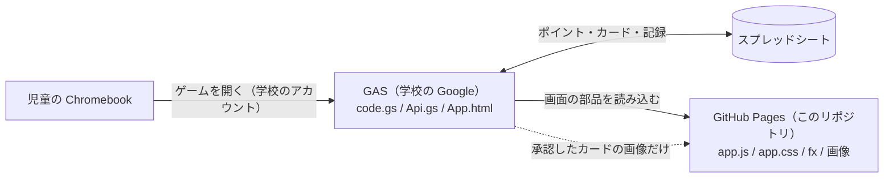

# 漢字の刃（画面のプログラムと素材）

小学6年生向けの漢字学習ゲーム「漢字の刃」のうち、**画面の見た目と動き（JavaScript・CSS・画像）** を置いているリポジトリです。
GitHub Pages で公開し、学校の Google（GAS）で動くゲームの画面から読み込まれます。

> ⚠️ **このリポジトリは誰でも見られます（Public）。**
> 児童の名前・出席番号・パスワード・メールアドレス・テストの点数、スプレッドシートのID、GAS の URL、合言葉（トークン）、クイズの正解、ガチャの確率は **絶対に置かないでください**。
> それらはすべて GAS とスプレッドシートの中だけにあります。

---

## 1. 全体のしくみ（はじめての人へ）

漢字の刃は **2つの場所** に分かれています。

| | GAS（Google Apps Script） | GitHub（このリポジトリ） |
|---|---|---|
| 置いてあるもの | サーバーのプログラム（`code.gs`・`Api.gs`）、外枠の HTML、今までの画面 | 新しい画面の動き（`app.js` など）、見た目（`app.css`）、演出（`fx/`）、カードと偉人の画像 |
| データ | スプレッドシート（児童・カード・記録） | **データは置かない** |
| 公開の範囲 | 学校のアカウント（昭島市教育委員会内）だけ | インターネットに公開 |
| 更新のしかた | GAS のエディタに貼り付け → 「新バージョン」でデプロイ | GitHub Desktop で commit → Push |
| 説明書 | `README_GAS.md`（GAS のファイルと一緒に、先生のパソコンに保管。**GitHub には置かない**） | この README |

- ポイント・ガチャの結果・勝ち負けなど、**大事なことはすべて GAS（サーバー）が決めます**。このリポジトリのプログラムは、見せ方だけを担当します。
- GitHub Pages のファイルが読めないときも、データは GAS とスプレッドシートにあるので消えません。

---

## 2. ファイルの一覧（`web/` フォルダ）

| ファイル | 中身 |
|---|---|
| `app.js` | 新しい1ページ型の画面（ログイン・マイページ・3Dカルーセル・ランキング）。先生のときは `admin.js`、カードを作るときは `cardmake.js` をあとから読み込む |
| `app.css` | 新しい画面の見た目（未来風のデザイン・カルーセル） |
| `theme.css` | マイページと同じ未来風の見た目を、ガチャ・バトル・図鑑・クイズ・ステップアップにもかける（GAS の FxBridge が読み込む） |
| `admin.js` | 先生の管理画面（児童一覧・ポイントの記録・ログインの記録・カードの承認）。**先生のときだけ**読み込む |
| `cardmake.js` | 「カードを作る」画面（児童が絵を申請する） |
| `fx/fx.js` | 演出（じゃんけん・サイコロ・ボス戦・ガチャ開封・宝箱・タップの粒など。ドット絵×アニメ風） |
| `fx/eras.js` | ステップアップバトルの「時代の背景」10種（埴輪・五重塔・金閣・黒船など） |
| `fx/demo.html` | 演出のお試しページ（ゲームのデータは使わない） |
| `assets/cards/番号.webp` | カードの画像（軽くした版）。`assets/cards/thumb/番号.webp` は小さい版（図鑑・一覧用） |
| `assets/ijin/番号.webp` | 偉人（ボス・仲間）の画像 |
| `assets/img/`・`assets/sound/` | 新しく作る画像・効果音の置き場所 |
| `index.html` | この URL を直接開いた人への案内だけ（ゲームは動かない・検索に載せない設定） |
| `robots.txt` | 予備 |

**ファイル名の決まり：** カードの画像は「カード番号.webp」です（例：87番 → `assets/cards/87.webp` と `assets/cards/thumb/87.webp`）。番号は、スプレッドシートの Characters シートの「ランク」と同じです。

---

## 3. 更新のしかた（GitHub Desktop）

1. このフォルダのファイルを書きかえる（または、送られてきたファイルで置きかえる）。
2. GitHub Desktop を開き、左の一覧で変えたファイルにチェックを入れる（`.DS_Store` はチェックを外す）。
3. 左下の「Summary」に何を変えたかを書いて「**Commit to main**」。
4. 上の「**Push origin**」を押す。
5. 1〜2分待つと GitHub Pages に公開される（リポジトリの「Actions」タブで緑のチェックが付けば完了）。
6. **GAS のスクリプト プロパティ `ASSET_VERSION` を新しい値にする**（例：`20261026a`）。
   - 次に画面を開いたときから、新しいファイルが使われます。
   - 上げ忘れても、最大10分ほどで自然に切り替わります（GitHub Pages が10分間ファイルを覚えているため）。

> GAS 側のファイル（`code.gs` など）を変えたときは、GitHub ではなく GAS のエディタに貼り付けます。くわしくは `README_GAS.md`。

---

## 4. カードの追加（児童の申請 → 先生の承認）

1. 児童がマイページの「🎨 カードを作る」から、絵・カード名・手・セリフを送る（審査中は1人1枚まで）。
2. 先生が管理画面の「🃏 カードの承認」で確かめ、レアリティとガチャの種類を決めて承認する。
3. GAS が、このリポジトリの `web/assets/cards/` と `web/assets/cards/thumb/` に画像を**自動で追加**する（コミットの名前は「カード 番号 を追加」）。
4. Characters シートのいちばん下にカードが追加され、作った児童に1枚プレゼントされる。

- 自動で追加するには、GAS のスクリプト プロパティに `GITHUB_TOKEN`（このリポジトリの Contents に書きこめる Fine-grained token）が必要です。**トークンはこの README やコードには書かない**でください。
- 絵が表示されるまで **1〜10分** かかります（公開まで約1分＋ブラウザが「まだない」を覚えている時間）。出ないときは10分ほど待って Ctrl＋Shift＋R。
- GitHub に送るのは画像だけです。作った児童の出席番号やニックネームは送りません。

---

## 5. はじめて公開するとき（設定済み）

1. GitHub でリポジトリを作る（このリポジトリは `kanji-yaiba-app`、Public）。
2. `web` フォルダごとアップロードする。
3. 「Settings」→「Pages」→ Source「Deploy from a branch」、Branch「main」「/ (root)」→「Save」。
4. `https://masaschool0106.github.io/kanji-yaiba-app/web/app.js` が開ければ公開できています。
5. GAS のスクリプト プロパティに `ASSET_BASE_URL`（上の URL から `app.js` を除いたもの）と `ASSET_VERSION` を入れる。

---

## 6. 2026年10月の大型アップデートで増えたもの

| 内容 | 主なファイル |
|---|---|
| 新しいマイページ（未来風デザイン・3Dカルーセル・テストの点数を Lv. で表示） | `app.js`・`app.css` |
| すべての画面を未来風に（画面に入るとパネルが出る・移るときの光の幕・ボタンが光る） | `theme.css` |
| メニューに「カードを作る」「バグ報告」、決め技の変更フォームへのリンク | `app.js` |
| バトル・ガチャの演出（ドット絵×アニメ、ガチャ開封・昇格・シルエット・サイン、宝箱、オーラ、タップの粒） | `fx/fx.js` |
| ステップアップバトルの時代の背景（10の時代） | `fx/eras.js` |
| 先生の管理画面 | `admin.js` |
| カードを作る（児童の申請） | `cardmake.js` |
| カード画像の軽量化（WebP・小さい版） | `assets/cards/` |

偉人の仲間（デッキ編成でえらぶ・最初の仲間つつジン・仲間の顔がすごろくのコマ）・歴史クイズ（100問）・図鑑のリニューアル・ガチャやログインの修正は GAS 側の変更です（`README_GAS.md` を参照）。

---

## 7. 困ったとき

| こまったこと | 確かめること |
|---|---|
| 新しくしたのに見た目が変わらない | Push したか／`ASSET_VERSION` を上げたか／10分待ったか |
| 「ゲームのファイルを読み込めませんでした」と出る | GitHub Pages が公開されているか（上の URL が開けるか）、`ASSET_BASE_URL` の値 |
| 承認したカードの絵が出ない | 10分ほど待って Ctrl＋Shift＋R／リポジトリに「カード 番号 を追加」のコミットがあるか |
| 演出が出ない | `fx/fx.js` が開けるか。GAS の FxBridge が正しいか（GAS の `checkGasFiles` で確かめる） |
| ほかの画面が未来風にならない | `theme.css` が開けるか／`ASSET_VERSION` を上げたか／GAS の FxBridge が最新か |
