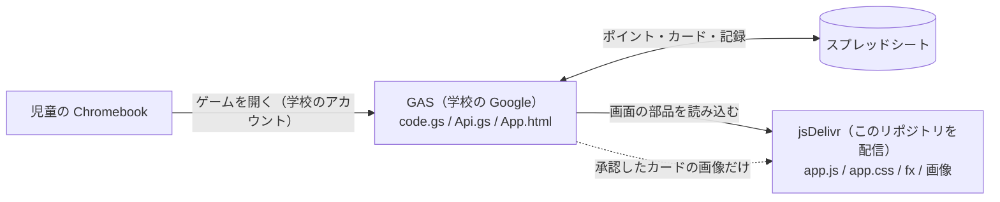

# 漢字の刃（画面のプログラムと素材）

小学6年生向けの漢字学習ゲーム「漢字の刃」のうち、**画面の見た目と動き（JavaScript・CSS・画像）** を置いているリポジトリです。
学校の Google（GAS）で動くゲームの画面が、**jsDelivr（cdn.jsdelivr.net）** を通してこのリポジトリのファイルを読み込みます。
（児童のタブレットでは、学校のネットワークで GitHub Pages〔github.io〕が開けないため）

> ⚠️ **このリポジトリは誰でも見られます（Public）。**
> 児童の名前・出席番号・パスワード・メールアドレス・テストの点数、スプレッドシートのID、GAS の URL、合言葉（トークン）、クイズの正解、ガチャの確率は **絶対に置かないでください**。
> それらはすべて GAS とスプレッドシートの中だけにあります。

---

## 1. 全体のしくみ（はじめての人へ）

漢字の刃は **2つの場所** に分かれています。

| | GAS（Google Apps Script） | GitHub（このリポジトリ） |
|---|---|---|
| 置いてあるもの | サーバーのプログラム（`code.gs`・`Api.gs`）、外枠の HTML、今までの画面 | 新しい画面の動き（`app.js` など）、見た目（`app.css`）、演出（`fx/`）、カードと偉人の画像 |
| データ | スプレッドシート（児童・カード・記録） | **データは置かない** |
| 公開の範囲 | 学校のアカウント（昭島市教育委員会内）だけ | インターネットに公開 |
| 更新のしかた | GAS のエディタに貼り付け → 「新バージョン」でデプロイ | GitHub Desktop で commit → Push |
| 説明書 | `README_GAS.md`（GAS のファイルと一緒に、先生のパソコンに保管。**GitHub には置かない**） | この README |



- ポイント・ガチャの結果・勝ち負けなど、**大事なことはすべて GAS（サーバー）が決めます**。このリポジトリのプログラムは、見せ方だけを担当します。
- jsDelivr のファイルが読めないときも、データは GAS とスプレッドシートにあるので消えません。

---

## 2. ファイルの一覧（`web/` フォルダ）

| ファイル | 中身 |
|---|---|
| `app.js` | 新しい1ページ型の画面（ログイン・マイページ・行き先の大きなタイル・ランキング）。先生のときは `admin.js`、カードを作るときは `cardmake.js` をあとから読み込む。キーボード：数字キーで行き先へ・矢印キーでえらぶ・M でメニュー |
| `app.css` | 新しい画面の見た目。ログイン・マイページはドット絵（2026-10-30 から）。カードを作る・レイド・管理画面は未来風のまま |
| `pixel.css` | ドット絵の見た目（PICO-8 の16色・DotGothic16・ドットの枠とボタン・メニュー）。GAS の FxBridge が読み込み、`fx/pixel.js` の一覧にある画面だけに効く |
| `fx/pixel.js` | ドット絵の部品（点のアイコン・城下町の背景・画面を出るときのタイル・光の点滅は1秒に2回まで）。いちばん上の `PAGES` に画面の名前を足すと、その画面がドット絵になる |
| `theme.css` | マイページと同じ未来風の見た目を、ガチャ・バトル・図鑑・クイズ・ステップアップにもかける（GAS の FxBridge が読み込む。ドット絵にした画面では使わない） |
| `admin.js` | 先生の管理画面（児童一覧・ポイントの記録・ログインの記録・カードの承認・カード一覧と編集・説明書）。**先生のときだけ**読み込む。承認・画像の差しかえのとき、子どもの絵をカードの型に当てはめた画像をこの画面で作る。説明書の文章はここには置かず、GAS から先生にだけ届く |
| `raid.js` | 巨大レイドボスの画面（週末・月末だけ。マイページの知らせを押すと読み込む）。正解・ダメージ・ごほうびはサーバーが決める |
| `cardmake.js` | 「カードを作る」画面（児童が絵・名前・手・ステップアップの効果を申請する） |
| `fx/fx.js` | 演出（じゃんけん・サイコロ〔ダブルダイスは2個〕・ボス戦・ガチャ開封〔パックはタップでやぶる。切れ目が横に走る〕・ダメージの掛け算〔×3 などが飛んできて数字が燃える〕・宝箱・宝箱ルーレット・貧乏神・WARNING とボス登場・手ごとの攻撃〔グー岩・チョキ斬撃・パー竜巻〕・総攻撃カットイン・覚醒・レイドボス・タップの粒など。ドット絵×アニメ風。光の点滅は1秒に2回まで） |
| `fx/eras.js` | ステップアップバトルの「時代の背景」10種（埴輪・五重塔・金閣・黒船など） |
| `fx/bgm.js` | ゲームの音楽（10/31〜）。音のファイルは使わず、ブラウザの中で音を作る。曲はすべてオリジナル（江戸風：五音音階・三味線・笛・琴・和太鼓ふう／ファミコン風：矩形波2つ・三角波・ノイズ）。ページと場面を見分けて曲を変える。最初のタップで鳴る。左下の 🔊/🔇 と 🎚（音量）は端末に覚える。はじめてオンにするかは、いちばん上の `DEFAULT_ON` |
| `fx/fudemaru.js` | ドット絵のふでまる（`KanjiFudemaru`。2026-11-03）。画像を読みこまず、色の表と点のならびからプログラムで描く。大きさ L（48×48）と S（20×20）、動きは10。canvas に描く・DOM で動かす、の両方に使える。マイページの「どこへ行く？」の右に出している（`app.js` があとから読みこむ）。使い方は下の「7. ドット絵のふでまる」 |
| `fx/demo.html` | 演出のお試しページ（ゲームのデータは使わない） |
| `assets/cards/番号.webp` | カードの画像（軽くした版）。`assets/cards/thumb/番号.webp` は小さい版（図鑑・一覧用） |
| `assets/ijin/番号.webp` | 偉人（ボス・仲間）の画像 |
| `assets/frames/` | カードの型（レアリティごとの `N.webp`〜`LEGEND.webp`。`+` は `plus`）と手のマーク（`hand_gu`・`hand_choki`・`hand_pa`）。管理画面がカードを作るときに使う |
| `assets/img/`・`assets/sound/` | 新しく作る画像・効果音の置き場所 |
| `assets/img/fudemaru_L.png`・`fudemaru_S.png` | ドット絵のふでまるのスプライトシート（`fx/fudemaru.js` と同じ絵。1行に1つの動き・左から順にコマ・背景は透明）。絵の元は `fx/fudemaru.js` なので、絵を直したら先生のパソコンの道具で作り直す（下の 7 章） |
| `index.html` | この URL を直接開いた人への案内だけ（ゲームは動かない・検索に載せない設定） |
| `robots.txt` | 予備 |

**ファイル名の決まり：** カードの画像は「カード番号.webp」です（例：87番 → `assets/cards/87.webp` と `assets/cards/thumb/87.webp`）。番号は、スプレッドシートの Characters シートの「ランク」と同じです。

---

## 3. 更新のしかた（GitHub Desktop）

> GAS が「いちばん新しいコミット」を自動で使うので、**Push すれば5分以内に反映**されます（`ASSET_VERSION` を変える必要はありません）。

1. このフォルダのファイルを書きかえる（または、送られてきたファイルで置きかえる）。
2. GitHub Desktop を開き、左の一覧で変えたファイルにチェックを入れる（`.DS_Store` はチェックを外す）。
3. 左下の「Summary」に何を変えたかを書いて「**Commit to main**」。
4. 上の「**Push origin**」を押す。
5. 5分ほど待って、画面を開き直す。
   - GAS は5分ごとに「いちばん新しいコミットの番号」を GitHub にたずね、jsDelivr のその番号のファイルを使います。

> GAS 側のファイル（`code.gs` など）を変えたときは、GitHub ではなく GAS のエディタに貼り付けます。くわしくは `README_GAS.md`。

---

## 4. カードの追加（児童の申請 → 先生の承認）

1. 児童がマイページの「🎨 カードを作る」から、絵・カード名・手・セリフを送る（審査中は1人1枚まで）。
2. 先生が管理画面の「🃏 カードの承認」で確かめ、レアリティとガチャの種類を決めて承認する。
3. GAS が、このリポジトリの `web/assets/cards/` と `web/assets/cards/thumb/` に画像を**自動で追加**する（コミットの名前は「カード 番号 を追加」）。
4. Characters シートのいちばん下にカードが追加され、作った児童に1枚プレゼントされる。

- 自動で追加するには、GAS のスクリプト プロパティに `GITHUB_TOKEN`（このリポジトリの Contents に書きこめる Fine-grained token）が必要です。**トークンはこの README やコードには書かない**でください。
- 承認した絵は、追加したコミットの番号つきの URL でシートに入るので、ふつうはすぐ表示されます。出ないときは数分待って開き直す。
- GitHub に送るのは画像だけです。作った児童の出席番号やニックネームは送りません。

---

## 5. はじめて公開するとき（設定済み）

1. GitHub でリポジトリを作る（このリポジトリは `kanji-yaiba-app`、Public）。
2. `web` フォルダごとアップロードする。
3. 「Settings」→「Pages」→ Source「Deploy from a branch」、Branch「main」「/ (root)」→「Save」。
4. `https://masaschool0106.github.io/kanji-yaiba-app/web/app.js` が開ければ公開できています。
5. GAS のスクリプト プロパティ `ASSET_BASE_URL` に **`https://cdn.jsdelivr.net/gh/masaschool0106/kanji-yaiba-app@main/web/`** を入れる（2026年10月に GitHub Pages から jsDelivr に切りかえ）。
6. GAS のエディタで `checkGasFiles` を実行し、「画面の部品・画像の置き場所」が `https://cdn.jsdelivr.net/gh/…@（英数字40文字）/web/` になっていれば完了。

---

## 6. 2026年10月の大型アップデートで増えたもの

| 内容 | 主なファイル |
|---|---|
| 新しいマイページ（未来風デザイン・3Dカルーセル・テストの点数を Lv. で表示） | `app.js`・`app.css` |
| すべての画面を未来風に（画面に入るとパネルが出る・移るときの光の幕・ボタンが光る） | `theme.css` |
| メニューに「カードを作る」「決め技・柱名の変更」「バグ報告」 | `app.js` |
| カードを作るときにステップアップの効果をえらぶ（効果の一覧は GAS の code.gs） | `cardmake.js`・`admin.js` |
| バトル・ガチャの演出（ドット絵×アニメ、ガチャ開封・昇格・シルエット・サイン、宝箱、オーラ、タップの粒） | `fx/fx.js` |
| ステップアップバトルの時代の背景（10の時代） | `fx/eras.js` |
| 先生の管理画面 | `admin.js` |
| カードを作る（児童の申請） | `cardmake.js` |
| カード画像の軽量化（WebP・小さい版） | `assets/cards/` |
| ドット絵の見た目（10/30〜）：ログイン・マイページ（3D の回転をやめて大きなタイル・1タップで移動・数字キー）、ほかの画面は順番に | `app.js`・`app.css`・`pixel.css`・`fx/pixel.js` |

偉人の仲間（デッキ編成でえらぶ・最初の仲間つつジン・仲間の顔がすごろくのコマ）・歴史クイズ（100問）・図鑑のリニューアル・ガチャやログインの修正は GAS 側の変更です（`README_GAS.md` を参照）。

**10月27日の追加**：管理画面のカード一覧・編集とカードの型（`admin.js`・`assets/frames/`）、巨大レイドボス（`raid.js`・`app.js`・`app.css`）、新しい演出（`fx/fx.js`）。覚醒の試練・ステップアップの分かれ道・サイコロ・アイテムは GAS 側（`README_GAS.md`）。

**10月27日（段階1）**：`fx/fx.js` にダメージの掛け算の演出（`KanjiFX.multiply`）と、ボス戦の「じゃんけん勝負！」（`janken` の `banner`・`plainTie`）を追加。

**11月3日（ドット絵のふでまる）**：`fx/fudemaru.js`・`assets/img/fudemaru_L.png`・`fudemaru_S.png` を追加。マイページの「どこへ行く？」の右に、ふでまるが立つ（開くと手をふってあいさつ・押すとよろこんで ひとこと）。`app.js`・`app.css`。GAS は変えていない。

---

## 7. ドット絵のふでまる（`fx/fudemaru.js`・`KanjiFudemaru`）

マスコット「ふでまる」（頭に筆・赤いはちまきに白い「漢」・たれ耳の犬）のドット絵です（2026-11-03）。
**画像を読みこまず、色の表と点のならび（文字の地図）から、プログラムで描きます**（生成AIは使っていません）。部品（頭・耳・はちまき・筆・体・うで・足・しっぽ）をポーズごとに組み立てて1コマにします。

### 大きさ

| 大きさ | 1コマ | 足もと（下の まん中） | 使うところ |
|---|---|---|---|
| `L` | 48×48 | (24, 48) | マイページのマスコット（2倍）、ステップアップの大きな絵、結果の画面 |
| `S` | 20×20 | (10, 20) | クイズ・ランナー（忍者 16×16 と同じくらい。体は約16点＋頭の上の筆）、すごろくのコマ |

- 向きは **右むき**（ランナーの進む向き）。左むきは `flip: true`。**左むきでも、はちまきの「漢」は鏡文字にしません**（部品を左右反対に置いて、字だけはそのまま描く）。
  - ⚠️ CSS の `transform: scaleX(-1)` や `ctx.scale(-1, 1)` で裏返すと「漢」が鏡文字になります。かならず `flip` を使ってください。
- 色は PICO-8 に近い色＋ふでまるの毛の色（`KanjiFudemaru.PAL`）。ふちどりは こげ茶。

### 動きの名前

| 名前 | 動き | L のコマ（1秒のコマ数） | S のコマ | くりかえす |
|---|---|---|---|---|
| `idle` | 立ち（ゆれる・しっぽをふる・ときどき まばたき） | 8（4） | 4（3） | ○ |
| `run` | 走る（耳がはねる・筆が後ろにかたむく） | 4（10） | 4（9） | ○ |
| `jump` | 上がる（足をたたむ・うでを上げる） | 2（8） | 1 | ○ |
| `fall` | 落ちる | 2（8） | 1 | ○ |
| `hop` | その場ジャンプ（しゃがむ→とぶ→着地） | 7（10） | 6（10） | 1回 |
| `joy` | よろこぶ（にっこり・ぴょんぴょん・きらきら） | 4（8） | 2（6） | ○ |
| `hurt` | ダメージ（＞＜・あせ） | 2（8） | 1 | ○ |
| `attack` | 一閃（ためて前へ） | 4（10） | 4（10） | 1回 |
| `lose` | しょんぼり（なみだ） | 2（2） | 1 | ○ |
| `wave` | 手をふる | 2（4） | 2（4） | ○ |

- `hop`・`joy` は、コマの外（上）へ はねます（`oy`。L は最大10点、S は最大5点上）。`draw` と `el` はこのずれを自動でつけます。
- ランナーのジャンプは、ゲームの計算（高さ）で上下させて、上がるとき `jump`・下がるとき `fall` を描きます。

### 関数

| 関数 | 中身 |
|---|---|
| `KanjiFudemaru.draw(ctx, 動き, ミリ秒, x, y, opts)` | canvas に描く。**x, y は足もとのまん中**。`opts = { size: 'L' か 'S', scale: 1, flip: false, tint: null }`。`tint` に色（例 `'#ff004d'`）を入れると、ふちと白以外をその色にする（ダメージの赤など）。返り値 `{ i: コマ, done: 1回の動きが終わったか }` |
| `KanjiFudemaru.el(opts)` | DOM 用：**自分で動く `<canvas>`** を作る。`opts = { size, scale: 2, anim: 'idle', flip, label }`。返り値の `.el` をページに置く。`.play('joy', { once: true, ms: 1000 })`（くりかえす動きを1秒だけ）・`.play('hop', { then: 関数 })`（1回の動きは、終わると前の動きにもどる）・`.flip(true)`・`.stop()`・`.start()`・`.destroy()`。上にジャンプ用のすきま（L 12点・S 6点）がある。ほかのタブ・画面の外では止まる。動きをへらす設定のときは1コマ目で止まる |
| `KanjiFudemaru.frame(動き, コマ, size, tint, flip)` | 1コマの canvas（等倍・作ったものは覚えておく） |
| `KanjiFudemaru.at(動き, ミリ秒, size, flip)` | その時間のコマ `{ i, canvas, oy, done }` |
| `KanjiFudemaru.indexAt(動き, ミリ秒, size)`・`count(動き, size)`・`offsetY(動き, コマ, size)` | コマの番号・コマの数・上下のずれ |
| `KanjiFudemaru.sheet(size)`・`layout(size)`・`sheetSize(size)` | 全部のコマを並べた canvas・その中の位置 `{ 動き: [{ x, y, w, h }] }`・大きさ（PNG と同じならび） |
| `KanjiFudemaru.names`・`SIZES`・`PAL`・`reducedMotion`・`version` | 動きの名前の一覧・大きさ・色の表・動きをへらす設定か・版 |

### 使い方の例

**読みこみ**：`app.js`（マイページ）は自分で読みこんでいます。ほかの画面（クイズ・ランナー、ステップアップ）は FxBridge を使っているので、GAS の `FxBridge.html` に1行足すのがかんたんです（fx.js などと同じ形）。

```html
<script defer src="<?= appAssetBase_() + 'fx/fudemaru.js' + appAssetQuery_() ?>" onerror="window.KanjiFudemaru = null"></script>
```

読みこめないときもゲームが止まらないように、`window.KanjiFudemaru` があるときだけ使い、ないときは今までの絵（忍者・仲間の顔）にしてください。

**canvas（クイズ・ランナー：160×90・`GROUND = 74`・忍者は `PLAYER_X` から 16×16）**

```js
// 忍者のかわりに描く。足もとのまん中を、忍者のまん中（PLAYER_X + 8, GROUND + py）に合わせる
const anim = hurt ? 'hurt' : (py < -1 ? (S.vy < 0 ? 'jump' : 'fall') : 'run');
KanjiFudemaru.draw(g, anim, performance.now() * (fever ? 1.5 : 1), PLAYER_X + 8, GROUND + py, { size: 'S', tint: hurt ? '#ff004d' : null });
```

**DOM（すごろくのコマ・マイページ）**

```js
const fude = KanjiFudemaru.el({ size: 'S', scale: 2, anim: 'idle' });   // 40×52 px（上の 12px はジャンプ用のすきま）
mass.appendChild(fude.el);   // 盤を作り直すときは、新しく作らずに同じ fude.el を今のマスへ動かす（使わなくなったら fude.destroy()）
fude.play('hop');            // 1マス進むたび（終わると idle にもどる）
```

**PNG だけで使う**（CSS のコマ送りなど）：`assets/img/fudemaru_L.png`（384×480）・`fudemaru_S.png`（120×200）。1行が1つの動きで、上から `idle, run, jump, fall, hop, joy, hurt, attack, lose, wave`。左から順にコマ（L は1コマ 48×48、S は 20×20）。`image-rendering: pixelated` で整数倍に大きくする。左むきの絵は PNG にはないので、左むきは `KanjiFudemaru` を使う。

### 絵を直すとき

1. `fx/fudemaru.js` の部品（`L.head`・`L.earL`・`LEG`・`ARM`・`S.head` など）か、動き（`ANIMS`）を直す。文字1つが1点、`.` は透明。色は上の `PAL`。
2. 先生のパソコンの模擬環境で `zsh mock/make_fudemaru_dot.sh` を動かす → `assets/img/fudemaru_L.png`・`fudemaru_S.png` が作り直される（見本の GIF もできる）。
3. テスト（`zsh mock/run_tests.sh`）で、コマの大きさ・はみ出し・左むきの「漢」・PNG が古くないかを確かめる。
4. Push する。

---

## 8. 困ったとき

| こまったこと | 確かめること |
|---|---|
| 新しくしたのに見た目が変わらない | Push したか／5分待ったか |
| 「ゲームのファイルを読み込めませんでした」と出る | `ASSET_BASE_URL` が jsDelivr の URL か／`checkGasFiles` の「置き場所」に `@（40文字）` が付いているか |
| 児童のタブレットだけ開けない（`ERR_TUNNEL_CONNECTION_FAILED`） | `ASSET_BASE_URL` が github.io のままになっていないか（学校のネットワークで止められている） |
| 承認したカードの絵が出ない | 数分待って開き直す／リポジトリに「カード 番号 を追加」のコミットがあるか |
| 演出が出ない | `fx/fx.js` が開けるか。GAS の FxBridge が正しいか（GAS の `checkGasFiles` で確かめる） |
| ほかの画面が未来風にならない | `theme.css` が開けるか／GAS の FxBridge が最新か |
